<h1 align="center">🎏 Koi Pond</h1>

<p align="center">
  <b>An animated koi pond for your GitHub profile README that grows with every contribution.</b><br/>
  Your koi hatches as a tiny pale fry. Every commit, pull request and issue feeds it.<br/>
  Hit milestones and new things appear in your pond, all the way up to a golden dragon.
</p>

<p align="center">
  <a href="https://adithyaherath.github.io/koi-Pond/"><b>▶ Try the live demo</b></a> ·
  <a href="#-add-it-to-your-profile"><b>Add it to your profile</b></a> ·
  <a href="#-milestones"><b>Milestones</b></a>
</p>

<p align="center">
  
  <br/><sub>↑ A real pond, live from <a href="https://github.com/AdithyaHerath">@AdithyaHerath</a>'s profile</sub>
</p>

---

## ✨ What is it?

Koi Pond is a **GitHub Action** that draws an animated SVG pond from your contribution history and saves it in your profile repository. You show it in your README like any image, and it updates on its own twice a day.

- 🐟 **Your koi grows a little with every contribution**, and changes colour at each milestone.
- 🪷 **The pond evolves.** Lily pads, reeds, lotus flowers, friends, moonlight, fireflies, sakura petals and a waterfall unlock as you go.
- 📊 **Shows your stats** with your all-time contribution count, your current stage, a progress bar to the next milestone and your contribution grid for the past year.
- 🎞️ **Fully animated** with swimming koi, wagging tails and rippling water. It's pure SVG, so it plays right inside your README.
- ⚙️ **Zero setup.** One workflow file, no API keys and no server. It uses the built-in `GITHUB_TOKEN`.

## 🌱 Milestones

| Contributions | Stage | What happens in your pond |
| --- | --- | --- |
| 0 | 🥚 **HATCHLING** | A tiny pale koi hatches in a quiet pond |
| 25 | 🐟 **FRY** | First orange scale · lily pads drift in |
| 100 | 🎏 **YOUNG** | Red Kohaku markings · reeds grow at the edges |
| 250 | 🐠 **JUVENILE** | Black sumi spots · a friend joins · pebbles settle |
| 500 | 🪷 **ADULT** | Blue back scales · lotus flowers bloom · a third koi |
| 1,000 | 🌕 **ELDER** | Metallic shimmer · the moon rises · fireflies |
| 2,000 | 🌸 **LEGEND** | Golden fins · sakura petals fall · a school of four |
| 5,000 | 🐉 **DRAGON** | The koi climbs the waterfall and becomes a dragon |

Your count is **all-time contributions**, added up across every year you've been on GitHub.

<table>
  <tr>
    <td align="center"><br/><b>YOUNG</b> · 150</td>
    <td align="center"><br/><b>ELDER</b> · 1,500</td>
    <td align="center"><br/><b>DRAGON</b> · 6,000</td>
  </tr>
</table>

## 🚀 Add it to your profile

It takes about two minutes. You need a **profile repository**, the special repo named exactly like your username (`your-username/your-username`). Its README shows on your GitHub profile. If you don't have one yet, [create it here](https://github.com/new) and tick **"Add a README file"**.

### Step 1: Add the workflow

In your profile repository, create the file **`.github/workflows/koi-pond.yml`** with this content:

```yaml
name: Feed the koi

on:
  schedule:
    - cron: "0 */12 * * *"   # twice a day
  workflow_dispatch:          # lets you run it by hand from the Actions tab

permissions:
  contents: write

jobs:
  grow:
    runs-on: ubuntu-latest
    steps:
      - uses: actions/checkout@v4

      - uses: AdithyaHerath/koi-Pond@v1
        with:
          output_path: koi-pond/pond.svg

      - name: Commit pond
        run: |
          git config user.name "github-actions[bot]"
          git config user.email "41898282+github-actions[bot]@users.noreply.github.com"
          git add koi-pond/pond.svg
          git diff --cached --quiet || (git commit -m "🎏 Feed the koi" && git push)
```

> 💡 On GitHub you can do this in the browser: **Add file → Create new file**, type `.github/workflows/koi-pond.yml` as the name, paste the content and click **Commit changes**.

### Step 2: Run it once

1. Open the **Actions** tab of your profile repository.
2. Click **Feed the koi** in the left sidebar.
3. Click **Run workflow → Run workflow**.

After about 30 seconds a new commit, **🎏 Feed the koi**, adds `koi-pond/pond.svg` to your repo.

> ⚠️ If the run fails with a *permission denied* / `403` error on push, go to **Settings → Actions → General → Workflow permissions**, select **Read and write permissions**, save and run it again.

### Step 3: Show it in your README

Add this anywhere in your profile `README.md`:

```html
<p align="center">
  
</p>
```

Done 🎉. Your pond now updates by itself twice a day. Run the workflow by hand anytime you want to see your koi right away.

<details>
<summary><b>Optional: add a milestone table under your pond</b></summary>

```html
<details>
<summary>🎏 <b>What is this pond?</b> Every contribution feeds my koi</summary>

| Contributions | Stage | What happens |
| --- | --- | --- |
| 0 | 🥚 HATCHLING | A tiny pale koi hatches |
| 25 | 🐟 FRY | First orange scale · lily pads |
| 100 | 🎏 YOUNG | Red markings · reeds |
| 250 | 🐠 JUVENILE | Black spots · a friend joins |
| 500 | 🪷 ADULT | Blue scales · lotus flowers |
| 1,000 | 🌕 ELDER | Shimmer · moon · fireflies |
| 2,000 | 🌸 LEGEND | Golden fins · sakura petals |
| 5,000 | 🐉 DRAGON | The koi becomes a dragon |

<sub>Made with <a href="https://github.com/AdithyaHerath/koi-Pond">Koi Pond</a></sub>
</details>
```

</details>

## ⚙️ Options

| Input | Default | Description |
| --- | --- | --- |
| `github_user` | repository owner | Whose contributions feed the koi |
| `github_token` | `GITHUB_TOKEN` | Token used to read contribution data. The default is enough. |
| `output_path` | `koi-pond/pond.svg` | Where the SVG is written. If you change it, update the `git add` line and your README image path too. |

The action also sets an output, `stage` (e.g. `ELDER`), that you can use in later steps.

## ❓ FAQ

**My count looks lower than on my profile.**
The action can only see what is public. If your profile shows private contributions, turn on **"Include private contributions on my profile"** in your [profile settings](https://github.com/settings/profile) so they're counted too.

**The image didn't change after a run.**
GitHub caches README images for a few minutes. Hard-refresh the page, or wait a moment.

**Does it spam my contribution graph?**
No. Commits are made by `github-actions[bot]` and don't count as your contributions.

**Can I run it on my own computer?**
Yes, with Node 18 or newer:

```bash
GITHUB_TOKEN=$(gh auth token) node src/generate.js your-username --out pond.svg
```

To preview any stage without a token, use `node src/generate.js your-username --count 1500 --out pond.svg`.

## 🧩 How it works

- [`src/generate.js`](src/generate.js) asks the GitHub GraphQL API for your contribution count in each year you've been active, plus last year's contribution calendar.
- [`src/render.js`](src/render.js) turns that into a self-contained animated SVG (SMIL animations, no scripts) that works inside GitHub's image proxy. It has no dependencies. The same file powers the [live demo](https://adithyaherath.github.io/koi-Pond/).
- [`action.yml`](action.yml) wraps both into a composite GitHub Action.

## 🤝 Contributing

Ideas for new pond events, koi varieties or milestones are welcome. Open an issue or a pull request. To try changes, open `index.html` through a local server (for example `python3 -m http.server`) and drag the slider.

If your pond made you smile, please ⭐ **star the repo** so more people can find it.

## 📄 License

[MIT](LICENSE) © Adithya Herath
